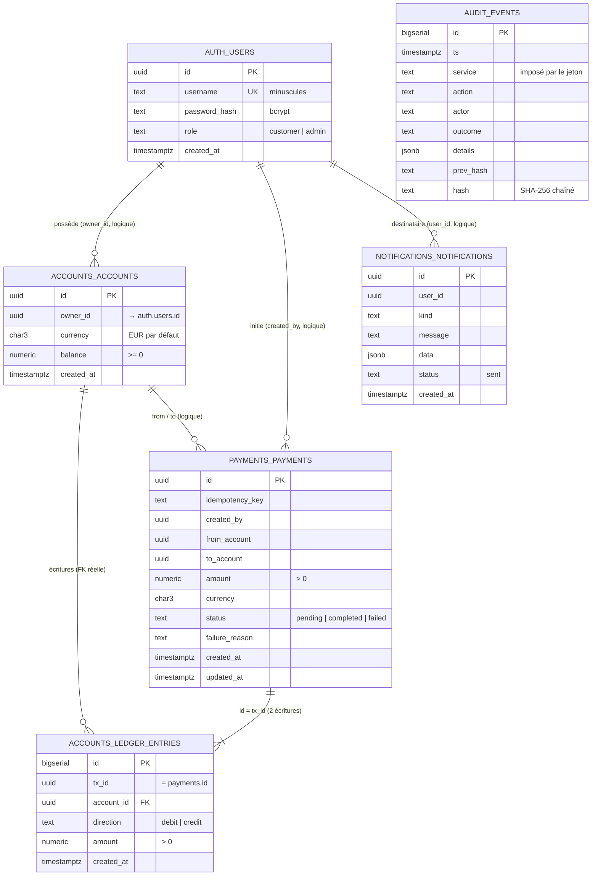

# RESILIENCE-ALPHA — Données, services et API (Swagger)

Document de référence technique : structure de chaque table, fonctionnement de chaque microservice et
documentation de leur API. Il complète le `README.md` (vue d'ensemble, démarrage, observabilité) et
`docs/02-reprise-idempotence-ml.md` (reprise, idempotence, détection ML).

Toutes les informations viennent du code (`services/*/app/main.py`, `libs/common`, `db/init/*.sql`) et ont été
vérifiées sur la pile en fonctionnement le 2026-10-19 (index, contraintes et droits relevés dans PostgreSQL).

## Sommaire

1. [Vue d'ensemble](#1-vue-densemble)
2. [Modèle de données](#2-modèle-de-données)
3. [Socle commun à tous les services](#3-socle-commun-à-tous-les-services)
4. [Les services un par un](#4-les-services-un-par-un)
5. [Passerelle Nginx](#5-passerelle-nginx)
6. [Swagger : consulter et régénérer la documentation d'API](#6-swagger--consulter-et-régénérer-la-documentation-dapi)
7. [Annexes : codes HTTP, événements, glossaire](#7-annexes)

---

## 1. Vue d'ensemble

```
Client ──► gateway (Nginx :8080) ──► auth · accounts · payments · notifications · audit      (/api/*)
                                       │
           payments ──/internal/transfer──► accounts          (règlement d'un paiement)
           tous ──/internal/events──► audit, notifications    (événements, au mieux)
           canary ──paiement réel via la passerelle──► … ──alerte──► remediation ──proxy Docker──► conteneurs
```

| Service | Schéma BDD | Rôle PostgreSQL | Port interne | Exposé par la passerelle |
|---|---|---|---|---|
| auth | `auth` | `svc_auth` | 8000 | `/api/auth/*` |
| accounts | `accounts` | `svc_accounts` | 8000 | `/api/accounts*` |
| payments | `payments` | `svc_payments` | 8000 | `/api/payments*` |
| notifications | `notifications` | `svc_notifications` | 8000 | `/api/notifications/*` |
| audit | `audit` | `svc_audit` | 8000 | `/api/audit/*` (admin) |
| remediation | aucun | aucun | 8000 | non (interne) |
| canary | aucun | aucun | 8000 | non (interne) |

**Conventions transverses**

- **Un schéma et un rôle par service.** Chaque service se connecte avec son propre rôle, dont le `search_path`
  est réglé sur son schéma : les requêtes du code n'ont pas de préfixe (`SELECT * FROM payments`). Aucun service
  n'exécute de DDL ; les tables sont créées par `db/init/02-schema.sql` à la création du volume.
- **Pas de clé étrangère entre schémas.** Les références d'un service à un autre (`owner_id`, `created_by`,
  `from_account`…) sont **logiques** : chaque service valide ce qu'il reçoit. Les domaines restent indépendants
  (un service peut être arrêté, restauré ou migré seul).
- **Montants** : `numeric(18,2)` en base, `Decimal` en Python, **chaînes** en JSON (`"74.50"`). Jamais de `float`.
- **Identifiants** : UUID v4 générés par PostgreSQL (`gen_random_uuid()`), sauf `ledger_entries.id` et
  `audit.events.id` (`bigserial`, l'ordre compte).
- **Dates** : `timestamptz`, renvoyées en ISO 8601 UTC (`2026-10-19T09:30:00+00:00`).

---

## 2. Modèle de données

### 2.1 Diagramme



Volumétrie relevée le 2026-10-19 après quelques heures de fonctionnement (la sonde écrit en continu) :
`auth.users` 15 · `accounts.accounts` 24 · `accounts.ledger_entries` 3 620 · `payments.payments` 1 809 ·
`notifications.notifications` 1 808 · `audit.events` 2 061. Rythme de fond dû à la sonde : environ
**12 paiements, 24 écritures, 12 notifications et 12 événements d'audit par minute**.

### 2.2 `auth.users` — utilisateurs

| Colonne | Type | Nul ? | Défaut | Contrainte / rôle |
|---|---|---|---|---|
| `id` | uuid | non | `gen_random_uuid()` | **PK** `users_pkey` |
| `username` | text | non | | **UNIQUE** `users_username_key`. Stocké en minuscules par le service ; 3–32 caractères `[a-zA-Z0-9_.-]` à l'inscription |
| `password_hash` | text | non | | Hash bcrypt (sel intégré, coût par défaut 12). Le mot de passe n'est jamais stocké ni journalisé |
| `role` | text | non | | **CHECK** `role IN ('customer','admin')` (`users_role_check`) |
| `created_at` | timestamptz | non | `now()` | |

- Index : `users_pkey (id)`, `users_username_key (username)` (sert aussi à la recherche au login).
- Droits de `svc_auth` : **SELECT, INSERT**. Pas d'UPDATE : pas de changement de mot de passe ni de rôle par
  l'API (le compte `admin` est créé au démarrage, `INSERT … ON CONFLICT (username) DO NOTHING`).
- Écrit par : `POST /api/auth/register`, démarrage d'auth (admin). Lu par : `POST /api/auth/login`.

### 2.3 `accounts.accounts` — comptes

| Colonne | Type | Nul ? | Défaut | Contrainte / rôle |
|---|---|---|---|---|
| `id` | uuid | non | `gen_random_uuid()` | **PK** `accounts_pkey` |
| `owner_id` | uuid | non | | Référence logique `auth.users.id` (le `sub` du jeton) |
| `currency` | char(3) | non | `'EUR'` | Code ISO à 3 lettres (validé `^[A-Z]{3}$` par le service) |
| `balance` | numeric(18,2) | non | `0` | **CHECK** `balance >= 0` (`accounts_balance_check`) : pas de découvert, garanti par la base |
| `created_at` | timestamptz | non | `now()` | |

- Index : `accounts_pkey (id)`, `accounts_owner_id_idx (owner_id)` (liste « mes comptes »).
- Droits de `svc_accounts` : **SELECT, INSERT, UPDATE** (le solde est mis à jour à chaque transfert).
- Invariant métier : `balance` = somme des crédits − somme des débits de ses écritures. Vérifié par
  `GET /internal/integrity`.

### 2.4 `accounts.ledger_entries` — écritures du ledger

| Colonne | Type | Nul ? | Défaut | Contrainte / rôle |
|---|---|---|---|---|
| `id` | bigserial | non | séquence | **PK** `ledger_entries_pkey` |
| `tx_id` | uuid | non | | Identifiant de la transaction : **= `payments.payments.id`** pour un paiement, UUID aléatoire pour le crédit initial d'un compte |
| `account_id` | uuid | non | | **FK** `ledger_entries_account_id_fkey` → `accounts.accounts(id)` (seule FK du modèle) |
| `direction` | text | non | | **CHECK** `direction IN ('debit','credit')` |
| `amount` | numeric(18,2) | non | | **CHECK** `amount > 0` |
| `created_at` | timestamptz | non | `now()` | |

- **UNIQUE** `(tx_id, account_id, direction)` (`ledger_entries_tx_id_account_id_direction_key`) : une même
  transaction ne peut pas débiter (ou créditer) deux fois le même compte, même sous concurrence. C'est la garantie
  d'idempotence finale des transferts (voir doc 02).
- Index : `ledger_entries_tx_id_idx (tx_id)` (test « déjà appliqué »), `ledger_entries_account_id_idx (account_id)`
  (contrôle d'intégrité).
- Droits de `svc_accounts` : **SELECT, INSERT seulement** : les écritures sont **immuables** (ni UPDATE ni DELETE).
- Un paiement produit exactement **2 lignes** de même `tx_id` : un débit sur le compte source, un crédit sur le
  compte destinataire. L'ouverture d'un compte avec un solde initial produit 1 crédit.

### 2.5 `payments.payments` — paiements

| Colonne | Type | Nul ? | Défaut | Contrainte / rôle |
|---|---|---|---|---|
| `id` | uuid | non | `gen_random_uuid()` | **PK**. Devient le `tx_id` du ledger |
| `idempotency_key` | text | non | | En-tête `Idempotency-Key` (8–64 caractères) |
| `created_by` | uuid | non | | Référence logique `auth.users.id` (initiateur, le `sub` du jeton) |
| `from_account`, `to_account` | uuid | non | | Références logiques `accounts.accounts.id` |
| `amount` | numeric(18,2) | non | | **CHECK** `amount > 0` |
| `currency` | char(3) | non | `'EUR'` | Devise déclarée par le client |
| `status` | text | non | | **CHECK** `status IN ('pending','completed','failed')` |
| `failure_reason` | text | oui | | Renseigné si `failed` : `insufficient_funds`, `account_not_found`, `not_account_owner`, `currency_mismatch` |
| `created_at`, `updated_at` | timestamptz | non | `now()` | `updated_at` change au passage à l'état final |

- **UNIQUE** `(created_by, idempotency_key)` : porte l'idempotence (une clé par utilisateur, pas globale).
- Index : `payments_status_created_at_idx (status, created_at)` pour le réconciliateur
  (`WHERE status = 'pending' AND created_at < now() - 10 s`), `payments_created_by_created_at_idx
  (created_by, created_at DESC)` pour l'historique d'un utilisateur.
- Droits de `svc_payments` : **SELECT, INSERT, UPDATE** (passage `pending` → état final).
- Cycle de vie : `pending` → `completed` | `failed`. Le passage est conditionnel
  (`UPDATE … WHERE id = $1 AND status = 'pending'`) : un paiement n'est réglé qu'une fois, même si la requête et le
  réconciliateur s'y attaquent en même temps.

### 2.6 `notifications.notifications` — notifications

| Colonne | Type | Nul ? | Défaut | Contrainte / rôle |
|---|---|---|---|---|
| `id` | uuid | non | `gen_random_uuid()` | **PK** |
| `user_id` | uuid | non | | Référence logique `auth.users.id` (destinataire) |
| `kind` | text | non | | `payment_completed`, `payment_failed` aujourd'hui (≤ 64 caractères) |
| `message` | text | non | | Texte affiché (≤ 500 caractères) |
| `data` | jsonb | non | `'{}'` | Données liées, ex. `{"payment_id": "…"}` |
| `status` | text | non | `'sent'` | L'envoi (e-mail) est simulé : toujours `sent` |
| `created_at` | timestamptz | non | `now()` | |

- Index : `notifications_user_id_created_at_idx (user_id, created_at DESC)` (« mes notifications »).
- Droits de `svc_notifications` : **SELECT, INSERT**.

### 2.7 `audit.events` — piste d'audit chaînée

| Colonne | Type | Nul ? | Défaut | Contrainte / rôle |
|---|---|---|---|---|
| `id` | bigserial | non | séquence | **PK**, ordre de la chaîne |
| `ts` | timestamptz | non | | Horodatage posé par le service audit (pas par l'émetteur) |
| `service` | text | non | | Service émetteur, **pris dans le jeton** (`sub`), jamais dans le corps |
| `action` | text | non | | Voir la liste en annexe (≤ 64 caractères) |
| `actor` | text | oui | | Nom d'utilisateur ou UUID ; `NULL` pour les actions système |
| `outcome` | text | non | | `success`, `failure`, `denied` (≤ 16 caractères) |
| `details` | jsonb | non | `'{}'` | Contexte (montant, IP, incident…) |
| `prev_hash` | text | non | | `hash` de l'événement précédent ; 64 zéros pour le premier |
| `hash` | text | non | | `SHA-256(prev_hash ∣ ts ∣ service ∣ action ∣ actor ∣ outcome ∣ details canonique)` |

- Index : `events_ts_idx (ts DESC)`, `events_action_idx (action)`.
- Droits de `svc_audit` : **SELECT, INSERT seulement** (ni UPDATE, ni DELETE, ni TRUNCATE).
- Écriture sérialisée par un verrou consultatif PostgreSQL (`pg_advisory_xact_lock(7001)`) : deux écritures
  simultanées ne peuvent pas lire le même `prev_hash`.
- `details` est sérialisé de façon canonique (`sort_keys`, sans espaces) avant le hachage : la vérification
  recalcule exactement la même chaîne.

### 2.8 Requêtes utiles (DBeaver, compte `pgadmin`)

```sql
-- Cohérence soldes / écritures : doit retourner 0 ligne
SELECT a.id, a.balance,
       COALESCE(SUM(CASE l.direction WHEN 'credit' THEN l.amount ELSE -l.amount END), 0) AS ledger
FROM accounts.accounts a LEFT JOIN accounts.ledger_entries l ON l.account_id = a.id
GROUP BY a.id, a.balance
HAVING a.balance <> COALESCE(SUM(CASE l.direction WHEN 'credit' THEN l.amount ELSE -l.amount END), 0);

-- Un paiement et ses deux écritures
SELECT p.id, p.status, p.amount, l.account_id, l.direction, l.amount
FROM payments.payments p JOIN accounts.ledger_entries l ON l.tx_id = p.id
WHERE p.id = '<uuid du paiement>';

-- Paiements restés en attente (réglés par le réconciliateur après une panne du ledger)
SELECT id, created_at, amount FROM payments.payments WHERE status = 'pending' ORDER BY created_at;

-- Activité hors sonde (exclure canary-bot)
SELECT p.status, count(*) FROM payments.payments p
WHERE p.created_by <> (SELECT id FROM auth.users WHERE username = 'canary-bot') GROUP BY 1;
```

---

## 3. Socle commun à tous les services

Bibliothèque `libs/common/resilience_common`, copiée dans chaque image.

### 3.1 Fabrique d'application (`app.py`)

`create_app(service, db_schema=…, startup=…, shutdown=…)` construit chaque service FastAPI avec :

| Endpoint | Rôle | Réponse |
|---|---|---|
| `GET /health` | Liveness : le processus répond | `{"status":"ok","service":…}` |
| `GET /ready` | Readiness : la base répond (`SELECT 1`, 2 s max) | 200 `ready` ou **503** `unready` |
| `GET /metrics` | Métriques Prometheus | texte |

Middleware : identifiant de corrélation `x-request-id` (repris de la passerelle ou généré, renvoyé dans la
réponse), compteurs `http_requests_total{service,method,path,status}` et histogramme
`http_request_duration_seconds` (le `path` est le **gabarit de route**, jamais l'URL réelle), log `http_request`
pour chaque requête hors santé (niveau WARNING si status ≥ 400). Toute exception non gérée donne un
`500 {"detail":"Erreur interne"}` sans détail technique, et un log `unhandled_exception`.

### 3.2 Sécurité (`security.py`)

| Élément | Détail |
|---|---|
| Mots de passe | bcrypt, tronqués à 72 octets (limite bcrypt), vérification dans un thread (calcul coûteux hors boucle) |
| Jeton utilisateur | JWT **HS256** signé avec `JWT_SECRET`, claims `iss="resilience-alpha"`, `sub` (UUID), `role`, `username`, `iat`, `exp` (15 min), `jti` |
| Jeton de service | même format, `role="service"`, `sub=<nom du service>`, durée **60 s**, créé à chaque appel interne |
| `require_roles(...)` | 401 sans jeton ou jeton invalide/expiré, 403 si le rôle n'est pas dans la liste |
| `require_service(...)` | rôle `service` **et** `sub` dans la liste : un service ne peut appeler que les endpoints internes prévus pour lui |

Limite assumée : tout service connaissant `JWT_SECRET` peut fabriquer n'importe quel jeton. Cible : clés
asymétriques par service (Vault).

### 3.3 Événements (`events.py`)

`audit(service, action, *, actor, outcome, **details)` et `notify(service, user_id, kind, message, **data)`
envoient un POST **asynchrone et au mieux** (délai 2 s) vers `audit` / `notifications`. Une panne de ces services
ne fait jamais échouer l'opération métier ; l'échec est journalisé (`event_delivery_failed`). Les deux premiers
paramètres sont positionnels uniquement : `service` peut aussi figurer dans les détails (correctif du
2026-10-19, voir doc 02).

### 3.4 Base et configuration

`create_pool(dsn, schema)` : pool asyncpg (1 à 5 connexions, `command_timeout` 10 s, `search_path` = schéma),
**30 tentatives espacées d'1 s** au démarrage (PostgreSQL peut démarrer après le service). `env(nom, défaut,
required=True)` lit la configuration ; les secrets n'arrivent que par l'environnement.

### 3.5 Logs (`logs.py`)

Une ligne JSON par événement sur stdout : `ts`, `level`, `service`, `logger`, `msg`, `request_id`, `event`
(snake_case, sert de clé de requête LogQL) et les champs propres à l'événement.

---

## 4. Les services un par un

Notation des accès : **public** (sans jeton), **jeton** (tout utilisateur connecté), **customer/admin** (rôles
utilisateur), **service:x** (jeton de service du service x).

### 4.1 auth — identité et jetons

**Rôle** : inscription, connexion, délivrance des JWT. Seul service qui connaît les mots de passe.

| Méthode, chemin | Accès | Entrée | Réponses |
|---|---|---|---|
| `POST /api/auth/register` | public | `RegisterIn {username (3–32, [a-zA-Z0-9_.-]), password (8–72)}` | **201** `UserOut {id, username, role}` · 409 nom pris · 422 validation |
| `POST /api/auth/login` | public | `LoginIn {username (≤64), password (≤128)}` | **200** `TokenOut {access_token, token_type="bearer", expires_in=900}` · 401 identifiants invalides · 429 trop de tentatives (`Retry-After`) |
| `GET /api/auth/me` | jeton | | **200** `{id, username, role}` (lu dans le jeton, sans requête en base) |

**Fonctionnement**

- Le nom d'utilisateur est mis en minuscules (unicité insensible à la casse).
- Anti-force brute : au-delà de **5 échecs en 60 s par IP ou par identifiant**, 429 + événement `login_blocked`.
  Compteurs en mémoire (remis à zéro si le service redémarre). S'ajoute à la limite Nginx (10 req/min/IP, rafale 5).
- Temps de réponse constant : si l'identifiant n'existe pas, un hash factice est quand même vérifié
  (pas d'énumération des comptes par chronométrage).
- Au démarrage, crée `admin` (rôle admin) si `ADMIN_PASSWORD` est défini.

| Configuration | Défaut | |
|---|---|---|
| `ACCESS_TTL_SECONDS` | 900 | Durée du JWT |
| `LOGIN_MAX_FAILURES` / `LOGIN_WINDOW_SECONDS` | 5 / 60 | Seuil anti-force brute |
| `ADMIN_PASSWORD`, `ADMIN_USERNAME` | –, `admin` | Compte administrateur |

Audit : `user_registered`, `login_success`, `login_failed`, `login_blocked` (avec `client_ip`).

### 4.2 accounts — comptes et ledger

**Rôle** : source de vérité des soldes. Tient le ledger (écritures immuables) et applique les transferts.

| Méthode, chemin | Accès | Entrée | Réponses |
|---|---|---|---|
| `POST /api/accounts` | customer, admin | `AccountCreate {currency="EUR" ([A-Z]{3}), initial_balance="1000.00" (0–100 000, 2 déc.)}` | **201** `AccountOut {id, owner_id, currency, balance, created_at}` |
| `GET /api/accounts/me` | jeton | | **200** liste d'`AccountOut` (ordre de création) |
| `GET /api/accounts/{account_id}` | propriétaire ou admin | UUID | **200** `AccountOut` · **404** si absent **ou appartenant à un autre** |
| `POST /internal/transfer` | **service:payments** | `TransferIn {tx_id, initiator_id, from_account, to_account, amount > 0}` | **200** `TransferOut {tx_id, status: "applied" \| "already_applied"}` · 404 `account_not_found` · 403 `not_account_owner` · 422 `same_account`, `currency_mismatch`, `insufficient_funds` |
| `GET /internal/integrity` | admin, service | | **200** `{consistent: bool, mismatches: [{account_id, balance, ledger_balance}]}` (50 max) |

**Transfert, pas à pas** (une seule transaction SQL) :

1. Refus si source = destination (422).
2. Verrouillage des deux comptes **dans l'ordre de leur id** (`SELECT … ORDER BY id FOR UPDATE`) : deux
   transferts croisés A→B et B→A ne peuvent pas s'interbloquer.
3. 404 si l'un des comptes n'existe pas ; 403 si la source n'appartient pas à l'initiateur.
4. Si des écritures existent déjà pour ce `tx_id` → `already_applied` (rien n'est débité).
5. 422 si devises différentes ou solde insuffisant.
6. Débit, crédit et 2 écritures. Une violation de l'unicité `(tx_id, account_id, direction)` (deux appels
   simultanés) est convertie en `already_applied`.

L'ouverture de compte écrit le compte et son crédit initial dans la **même transaction**. Le crédit initial est
une fonction de **démonstration** (argent fictif), à retirer en production.

Audit : `account_opened`. Logs : `transfer_applied`, `integrity_violation` (ERROR).

### 4.3 payments — paiements

**Rôle** : reçoit les demandes de paiement, les enregistre, demande le règlement au ledger et garantit qu'un
paiement n'est exécuté qu'une fois.

| Méthode, chemin | Accès | Entrée | Réponses |
|---|---|---|---|
| `POST /api/payments` | customer, admin | En-tête **`Idempotency-Key`** (8–64, obligatoire) ; `PaymentIn {from_account, to_account, amount > 0 (2 déc.), currency="EUR"}` | **201** nouveau paiement · **200** rejeu de la même clé · 409 clé réutilisée avec un autre contenu · 422 validation, comptes identiques, plafond · **503** `{"detail": {"error":"ledger_unavailable","payment_id":…,"status":"pending"}}` + `Retry-After: 5` |
| `GET /api/payments` | jeton | `?limit=` 1–200 (défaut 50) | **200** ses paiements, du plus récent au plus ancien |
| `GET /api/payments/{payment_id}` | propriétaire ou admin | UUID | **200** `PaymentOut` · 404 |

`PaymentOut = {id, from_account, to_account, amount, currency, status, failure_reason, created_at, updated_at}`.

**Création, pas à pas**

1. 422 si comptes identiques. 422 + audit `payment_rejected` si `amount > PAYMENT_MAX_AMOUNT` (rien n'est enregistré).
2. `INSERT … status='pending' ON CONFLICT (created_by, idempotency_key) DO NOTHING`.
   Pas de ligne insérée → c'est un **rejeu** : on relit le paiement existant ; 409 si `from/to/amount` diffèrent.
3. Si le paiement est `pending`, **règlement** : `POST accounts/internal/transfer` avec `tx_id = id du paiement`.
   - 200 → `completed` ;
   - erreur réseau, 401, 408, 429, 5xx → **reste `pending`** (erreur transitoire, on ne conclut pas) ;
   - autre refus (403, 404, 422) → `failed` + `failure_reason`.
   Le passage à l'état final est conditionnel (`WHERE status='pending'`).
4. Toujours `pending` → 503 avec l'identifiant du paiement. Sinon 201 (nouveau) ou 200 (rejeu).

**Réconciliateur** (tâche de fond) : toutes les `RECONCILE_INTERVAL_SECONDS` (15 s), rejoue jusqu'à 20 paiements
`pending` de plus de 10 s. C'est ce qui règle automatiquement les paiements après le retour du ledger.

| Configuration | Défaut | |
|---|---|---|
| `ACCOUNTS_URL` | `http://accounts:8000` | Ledger |
| `PAYMENT_MAX_AMOUNT` | 5000 | Plafond par paiement |
| `RECONCILE_INTERVAL_SECONDS` | 15 | Période du réconciliateur |

Métrique : `payments_total{status}`. Audit : `payment_completed`, `payment_failed`, `payment_rejected`.
Notification envoyée à l'initiateur à chaque état final. Logs : `ledger_unreachable`, `ledger_error`,
`payment_reconciled`.

### 4.4 notifications — notifications (envoi simulé)

| Méthode, chemin | Accès | Entrée | Réponses |
|---|---|---|---|
| `POST /internal/events` | service:payments, auth, remediation | `EventIn {user_id, kind (≤64), message (≤500), data={}}` | **202** `{id}` |
| `GET /api/notifications/me` | jeton | `?limit=` 1–200 (défaut 50) | **200** liste `{id, kind, message, data, status, created_at}` |

L'« envoi » est un log `notification_sent` avec `channel="email_simulated"`. Métrique
`notifications_sent_total{kind}`. Aujourd'hui seul payments émet des notifications.

### 4.5 audit — piste d'audit infalsifiable

| Méthode, chemin | Accès | Entrée | Réponses |
|---|---|---|---|
| `POST /internal/events` | tout service | `AuditIn {action (≤64), actor?, outcome="success" (≤16), details={}}` | **201** `{id}` |
| `GET /api/audit/events` | admin | `?service=&action=&limit=` (1–500, défaut 100) | **200** événements, du plus récent au plus ancien |
| `GET /api/audit/verify` | admin | | **200** `{valid, checked, first_invalid_id}` (recalcule jusqu'à 100 000 événements) |

Le service émetteur est **pris dans le jeton** : un service compromis ne peut pas écrire au nom d'un autre.
Une altération (UPDATE manuel, suppression) est détectée par `verify` et journalisée `audit_chain_broken` (ERROR).
Limite : sans ancrage externe du dernier hash, un superutilisateur PostgreSQL pourrait réécrire toute la chaîne.

### 4.6 remediation — moteur de reprise (interne)

| Méthode, chemin | Accès | Entrée | Réponses |
|---|---|---|---|
| `POST /internal/alerts` | **service:detector, canary** | `AlertIn {source, service ∈ auth\|accounts\|payments\|notifications, type ∈ service_down\|availability_degraded\|anomaly, severity="high", score?, details={}}` | **202** `{incident_id, deduplicated}` ou `{incident_id, suppressed:true}` |
| `GET /internal/incidents` | admin, service | | 200 incidents récents (200 max, **en mémoire**) |
| `GET /internal/incidents/{id}` | admin, service | | 200 incident avec `timeline` · 404 |

Fonctionnement détaillé (machine à états, garde-fous, preuve de reprise) : **doc 02, section 1**.

| Configuration | Défaut | |
|---|---|---|
| `DOCKER_API_URL` | `http://docker-proxy-remediation:2375` | Proxy Docker restreint (jamais le socket) |
| `RECOVERY_TIMEOUT_SECONDS` | 90 | Attente max du retour de `/ready` |
| `REMEDIATION_MAX_PER_WINDOW` / `REMEDIATION_WINDOW_SECONDS` | 3 / 600 | Disjoncteur |

Métriques : `remediation_incidents_total{service,status}`, `remediation_active_incidents`,
`remediation_recovery_seconds`. Audit : `incident_opened|resolved|failed|escalated|suppressed`.

### 4.7 canary — sonde synthétique (interne)

| Méthode, chemin | Accès | Réponse |
|---|---|---|
| `GET /internal/probe` | admin, service | Exécute une transaction de contrôle immédiate et renvoie son résultat |
| `GET /internal/status` | admin, service | `{last, consecutive_failures}` |
| `GET /internal/history` | admin, service | 120 derniers résultats |

Un résultat = `{ts, ok, duration_ms, ready: {service: bool}, consistent, failed_phase, error, payment_id}`.

Toutes les 5 s : vérifie `/ready` des 4 services métier, se connecte (compte `canary-bot`, créé
automatiquement), ouvre deux comptes au premier passage, fait un paiement de **0,01 €** d'un compte vers l'autre
**via la passerelle**, puis contrôle l'intégrité du ledger. Après 3 échecs consécutifs, alerte la remédiation
(une alerte par service toutes les 30 s au plus). Métriques `canary_*` (voir README 10.2).

---

## 5. Passerelle Nginx

`gateway/nginx.conf` — seul composant exposé (`0.0.0.0:8080`).

| Chemin | Destination | Particularités |
|---|---|---|
| `= /api/auth/login` | auth | **Limite 10 req/min par IP**, rafale 5, puis 429 |
| `/api/auth` | auth | |
| `/api/accounts` | accounts | |
| `/api/payments` | payments | |
| `/api/notifications` | notifications | |
| `/api/audit` | audit | Rôle admin vérifié par le service |
| `^~ /internal/` | — | **404** : jamais exposé |
| `= /gateway-health` | — | 200 `ok` (santé du conteneur) |
| `/` (reste) | — | 404 JSON (`/docs`, `/metrics`, `/ready` des services ne sont pas routés) |

Réglages : résolution DNS dynamique (`resolver 127.0.0.11 valid=5s` + variable) pour retrouver un service
redémarré sans recharger Nginx ; corps limité à 64 ko ; délais 2 s (connexion) / 10 s (lecture) ;
`X-Real-IP` et `X-Request-ID` posés par la passerelle (valeurs du client écrasées) ; en-têtes
`X-Content-Type-Options: nosniff`, `X-Frame-Options: DENY`, `Cache-Control: no-store` ; journal d'accès JSON
(`remote_addr`, `method`, `uri`, `status`, `request_time`, `upstream_time`, `bytes_sent`, `user_agent`,
`request_id`) — c'est la source principale de la détection ML (doc 02, section 3).

---

## 6. Swagger : consulter et régénérer la documentation d'API

Chaque service FastAPI produit sa spécification **OpenAPI 3** à partir de son code (modèles Pydantic, paramètres,
dépendances de sécurité). Elles sont exportées dans `docs/api/<service>.openapi.json` (livrable « documentation
d'API »).

### 6.1 Consulter

**Visionneuse fournie (recommandé)** : une page Swagger UI qui charge les 7 spécifications.

```bash
python -m http.server 8088 --directory docs/api
# puis ouvrir http://localhost:8088 et choisir le service dans la liste en haut à droite
```

(Le bouton « Try it out » est désactivé : les services ne sont joignables que par la passerelle, avec un jeton.)

**Autres options** : coller un fichier JSON dans https://editor.swagger.io ; extension VS Code « OpenAPI (Swagger)
Editor » ; `/docs` d'un service n'est **pas** accessible depuis l'hôte (réseau Docker interne, non routé par la
passerelle) — c'est voulu.

### 6.2 Régénérer après une modification d'endpoint

```bash
pip install -r requirements-dev.txt     # une fois (idéalement dans un venv)
python scripts/export_openapi.py        # réécrit docs/api/*.openapi.json
```

Le script importe chaque application sans la démarrer (aucune base nécessaire).

### 6.3 Tester une API à la main (via la passerelle)

```bash
TOKEN=$(curl -s -X POST localhost:8080/api/auth/login -H 'Content-Type: application/json' \
  -d '{"username":"alice","password":"MotDePasse-123"}' | python -c "import sys,json;print(json.load(sys.stdin)['access_token'])")

curl -s localhost:8080/api/accounts/me -H "Authorization: Bearer $TOKEN"

curl -s -X POST localhost:8080/api/payments -H "Authorization: Bearer $TOKEN" \
  -H 'Content-Type: application/json' -H "Idempotency-Key: $(python -c 'import uuid;print(uuid.uuid4())')" \
  -d '{"from_account":"<uuid>","to_account":"<uuid>","amount":"12.50"}'
```

---

## 7. Annexes

### 7.1 Codes HTTP

| Code | Sens dans la plateforme |
|---|---|
| 200 / 201 / 202 | Succès. Paiement : 201 = créé, 200 = rejeu d'une clé déjà vue. 202 = événement accepté |
| 401 | Jeton absent, invalide ou expiré ; identifiants faux au login |
| 403 | Rôle insuffisant ; service appelant non autorisé ; compte source d'un autre (transfert) |
| 404 | Inexistant **ou appartenant à un autre** (pas d'énumération) ; tout `/internal/*` via la passerelle |
| 409 | Nom d'utilisateur pris ; `Idempotency-Key` réutilisée avec un contenu différent |
| 422 | Validation (format, plafond, comptes identiques, devise, solde au niveau du ledger) |
| 429 | Trop de tentatives de connexion (`Retry-After`) |
| 502 / 504 | Passerelle : service arrêté ou trop lent |
| 503 | `/ready` sans base ; paiement enregistré mais ledger indisponible (`Retry-After: 5`) |

Erreurs : `{"detail": "message"}` ; validation 422 : `{"detail": [{loc, msg, type}]}`.

### 7.2 Actions d'audit

`user_registered`, `login_success`, `login_failed`, `login_blocked`, `account_opened`, `payment_completed`,
`payment_failed`, `payment_rejected`, `incident_opened`, `incident_resolved`, `incident_failed`,
`incident_escalated`, `incident_suppressed`.

### 7.3 Glossaire

- **Ledger** : registre des écritures (débits, crédits) dont découlent les soldes.
- **Idempotence** : rejouer la même requête produit le même résultat sans effet supplémentaire.
- **Sonde (canary)** : client automatique qui exécute en continu une vraie transaction pour prouver que le
  service est utilisable.
- **Disjoncteur** : limite le nombre de remédiations pour éviter les boucles de redémarrage.
- **Jeton de service** : JWT de 60 s qui identifie le service appelant dans un appel interne.
