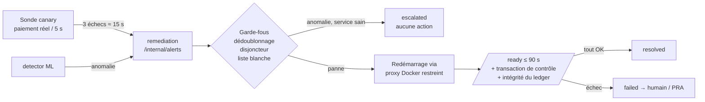
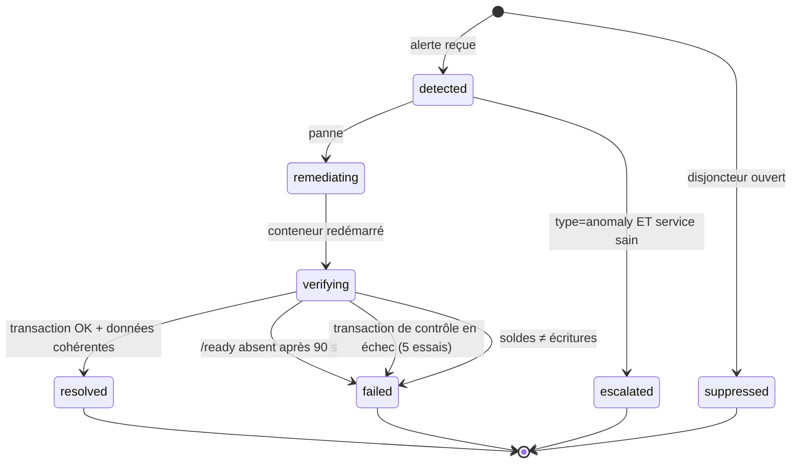
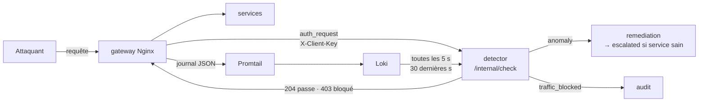

# RESILIENCE-ALPHA — Reprise sur erreur, idempotence et détection ML

Ce document explique comment la plateforme se comporte quand quelque chose casse, pourquoi un paiement n'est
jamais exécuté deux fois, et comment entraîner puis brancher un **Isolation Forest** qui détecte le trafic
d'attaque en temps réel et le bloque à la passerelle.

Référence des tables et des API : `docs/01-donnees-et-services.md`. Les comportements décrits ont été vérifiés
sur la pile réelle le 2026-10-19 (pannes provoquées avec `docker stop`, attaques simulées avec `ml/traffic.py`).

## Sommaire

1. [Reprise en cas d'erreur](#1-reprise-en-cas-derreur)
2. [Idempotence, service par service](#2-idempotence-service-par-service)
3. [Détection ML (Isolation Forest) et blocage des attaquants](#3-détection-ml-isolation-forest-et-blocage-des-attaquants)

---

## 1. Reprise en cas d'erreur

### 1.1 Le principe : détecter, décider, agir, **prouver**

Un conteneur qui redémarre ne prouve rien. La plateforme considère un incident clos seulement quand une
**nouvelle transaction réelle réussit** et que les **données sont cohérentes**.



### 1.2 Mécanismes de reprise, couche par couche

| Couche | Mécanisme | Effet |
|---|---|---|
| Démarrage | `depends_on: postgres (healthy)` ; pool asyncpg : 30 tentatives × 1 s | Un service démarré avant la base attend au lieu de planter |
| Santé | `HEALTHCHECK` Docker sur `/ready` toutes les 5 s (la base doit répondre) | `docker compose ps` et la sonde voient un service sans base comme indisponible |
| Passerelle | Résolution DNS dynamique (5 s), délais 2 s / 10 s | Un service redémarré est retrouvé sans recharger Nginx ; un service arrêté donne 502, pas un blocage |
| Appels internes | Délais courts (2 à 5 s) ; jetons de service de 60 s recréés à chaque appel | Une panne d'un service ne bloque pas indéfiniment ses appelants |
| Événements | `audit()` / `notify()` asynchrones « au mieux » | Audit ou notifications en panne ⇒ le paiement réussit quand même (`event_delivery_failed` journalisé) |
| Paiements | État `pending` + 503 + **réconciliateur** (15 s) | Ledger en panne ⇒ la demande est conservée et réglée automatiquement au retour, sans double débit |
| Détection | Sonde : 3 échecs consécutifs (~15 s) ; détecteur ML (section 3) | Alerte vers la remédiation |
| Action | Remédiation : redémarrage du conteneur via un proxy qui n'autorise que stop/restart/kill | Aucun service ne possède le socket Docker |
| Preuve | `/ready` + transaction de contrôle (5 essais) + `/internal/integrity` | `resolved` seulement si le service est réellement utilisable et les soldes justes |
| Politique Docker | `restart: "no"` sur les 4 services métier ; `unless-stopped` sur le reste | La reprise des services métier est l'œuvre du moteur, donc démontrable |

### 1.3 Le moteur de remédiation en détail

**États d'un incident**



**Garde-fous**

| Garde-fou | Règle | Pourquoi |
|---|---|---|
| Émetteurs autorisés | Seuls `canary` et `detector` (jeton de service) peuvent alerter | Un service compromis ne peut pas déclencher de redémarrages |
| Liste blanche | `rsl-auth`, `rsl-accounts`, `rsl-payments`, `rsl-notifications` uniquement | Jamais PostgreSQL, ni le moteur lui-même, ni le proxy |
| Dédoublonnage | Un seul incident actif par service | Les alertes répétées pendant une reprise ne relancent rien |
| Disjoncteur | 3 remédiations par service en 10 min, ensuite `suppressed` + audit | Évite les boucles de redémarrage ; limite l'effet d'une alerte forgée |
| Anomalie ≠ panne | `anomaly` sur un service sain ⇒ `escalated`, **aucune action** | Une compromission ne se corrige pas en redémarrant ; redémarrer effacerait les preuves |
| Proxy Docker | `POST=1, ALLOW_RESTARTS=1, CONTAINERS=0` : seuls `stop|restart|kill` passent | Vérifié : liste et création de conteneurs refusées (403), redémarrage accepté (204) |

### 1.4 Que se passe-t-il quand… (matrice de pannes)

| Composant en panne | Ce que voient les clients | Détection | Reprise | Données |
|---|---|---|---|---|
| **payments** | 502 sur `/api/payments` (le front propose « Réessayer » avec la même clé) | Sonde : paiement en échec, `/ready` payments KO | Redémarrage par la remédiation | Rien de perdu : les paiements déjà enregistrés sont en base |
| **accounts** (ledger) | Création de paiement : **503 `pending`**, puis passage à `completed` tout seul | Sonde | Redémarrage, puis le réconciliateur règle les `pending` (≤ 15 s) | Aucun double débit (idempotence du transfert) |
| **auth** | Connexion et inscription impossibles (502). Les sessions ouvertes **continuent** (JWT vérifiés localement) | `/ready` auth KO, mais la sonde ne voit l'échec qu'au renouvellement de son jeton : **jusqu'à ~14 min** (limite, 1.7) | Redémarrage dès que la sonde alerte (ou le détecteur) | Compteurs anti-force brute remis à zéro |
| **notifications** | Paiements OK ; notifications manquantes pendant la panne | `/ready` KO mais **la sonde n'alerte pas** (paiement réussi) — limite, 1.7 | Pas de remédiation automatique aujourd'hui | Notifications de la période **perdues** (envoi au mieux, sans file) |
| **audit** | Rien de visible | Logs `event_delivery_failed` | `restart: unless-stopped` (si le processus meurt) | Événements de la période **perdus** (au mieux) |
| **PostgreSQL** | Tous les services `/ready` = 503 ; erreurs 500/503 | Sonde (tous les services KO) | **Hors remédiation** (jamais redémarré par le moteur) : `unless-stopped`, sinon humain | Volume `pgdata` ; restauration = PRA |
| **gateway** | Plateforme injoignable | Sonde (elle passe par la passerelle) | `unless-stopped` | – |
| **remediation** | Rien ; plus de reprise automatique | Grafana (`up` = 0) | `unless-stopped` | Historique en mémoire perdu (l'audit le conserve) |
| **canary** | Rien ; plus de preuve ni d'alerte de secours | Grafana | `unless-stopped` | – |
| **detector** (option) | Rien : la passerelle laisse passer (ouverture par défaut) | Grafana (`up` = 0) | `unless-stopped` | Liste de blocage en mémoire perdue |
| Prometheus / Loki / Grafana | Rien | – | `unless-stopped` | Métriques et logs non persistés (`down` les efface) |

### 1.5 Durées mesurées (pile réelle, 2026-10-19)

| Scénario | Mesure |
|---|---|
| `docker stop rsl-payments` → service de nouveau opérationnel | 25 à 34 s (détection ~15 s + redémarrage + preuve) |
| Durée « alerte → reprise prouvée » (`remediation_recovery_seconds`) | 2,5 à 4,6 s pour payments et accounts |
| `docker stop rsl-accounts` pendant un paiement → paiement `completed` sans action | ~70 s (détection, reprise, puis cycle du réconciliateur) |

### 1.6 Deux défauts corrigés le 2026-10-19 (la reprise ne fonctionnait pas avant)

1. **Chaque alerte faisait planter le moteur** : `TypeError: audit() got multiple values for argument 'service'`
   (le moteur passe `service=` dans les détails d'audit). L'incident restait « actif » et toutes les alertes
   suivantes étaient dédoublonnées : aucun redémarrage n'avait jamais lieu. Correctif : paramètres positionnels
   uniquement dans `events.audit()` / `notify()` + test de non-régression.
2. **Le proxy Docker refusait tous les redémarrages (403)** : avec `POST=0`, HAProxy rejette tout non-GET avant
   d'appliquer `ALLOW_RESTARTS`. Correctif : `POST=1, ALLOW_RESTARTS=1, CONTAINERS=0`.

### 1.7 Limites connues et pistes

| Limite | Conséquence | Piste |
|---|---|---|
| La sonde réutilise son jeton ~14,5 min | Une panne d'**auth** n'est pas détectée avant l'expiration du jeton | Faire échouer la sonde dès qu'un `/ready` est KO, ou se reconnecter à chaque sonde |
| La sonde n'échoue pas quand **notifications** tombe | Pas de remédiation automatique de notifications | Alerter sur `ready=false` même si la transaction réussit |
| Disjoncteur partagé | 3 échecs (ou escalades d'anomalie) en 10 min ⇒ la panne suivante est `suppressed` | Ne compter que les redémarrages effectifs ; plafond séparé pour les anomalies |
| Incidents en mémoire | Perdus si le moteur redémarre | Persister (table dédiée) ; l'audit garde déjà la trace |
| Événements « au mieux » | Audit et notifications perdus pendant leur panne | File d'attente (outbox) avec rejeu idempotent |
| PostgreSQL unique | Point de défaillance unique | Réplication + sauvegardes testées (PRA) |

---

## 2. Idempotence, service par service

**Définition** : une opération est idempotente si l'exécuter plusieurs fois a le même effet que l'exécuter une
fois. C'est ce qui permet de **réessayer sans risque** après une erreur réseau, un 502 ou un délai dépassé —
exactement ce qui arrive pendant une panne.

### 2.1 Vue d'ensemble

| Service · opération | Idempotent ? | Mécanisme | Si on rejoue |
|---|---|---|---|
| **payments** · `POST /api/payments` | **Oui** | `Idempotency-Key` + `UNIQUE(created_by, idempotency_key)` | Même paiement renvoyé (200), aucun nouveau débit ; 409 si le contenu diffère |
| **accounts** · `POST /internal/transfer` | **Oui** | `tx_id` = id du paiement ; test préalable + `UNIQUE(tx_id, account_id, direction)` | `already_applied`, aucun mouvement |
| payments · réconciliateur | **Oui** | Rejoue le transfert avec le même `tx_id` ; passage d'état conditionnel `WHERE status='pending'` | Un paiement n'est réglé qu'une fois, même en concurrence avec la requête initiale |
| auth · `POST /api/auth/register` | Non, mais **sans danger** | `UNIQUE(username)` | 2ᵉ essai ⇒ 409 (le compte existe déjà) |
| auth · `POST /api/auth/login` | Oui (lecture) | – | Un nouveau jeton à chaque fois ; un échec compte dans l'anti-force brute |
| **accounts** · `POST /api/accounts` | **Non** | – | **Un compte de plus** (avec un nouveau crédit de démonstration) |
| notifications · `POST /internal/events` | Non | – | Notification en double (aujourd'hui l'émetteur ne rejoue jamais) |
| audit · `POST /internal/events` | Non (ajout seul) | – | Événement en double, chaîne toujours valide (l'émetteur ne rejoue jamais) |
| remediation · `POST /internal/alerts` | Partiellement | Un incident actif par service | Pendant une reprise : dédoublonné ; après : nouvel incident (borné par le disjoncteur) |
| Tous les `GET` | Oui | Lecture seule | – |

### 2.2 Le paiement, de bout en bout

```mermaid
sequenceDiagram
    participant C as Client (front)
    participant P as payments
    participant A as accounts (ledger)
    C->>P: POST /api/payments  Idempotency-Key: K
    P->>P: INSERT pending ON CONFLICT (created_by, K) DO NOTHING
    alt clé déjà vue
        P->>P: relit le paiement ; contenu différent ⇒ 409
    end
    P->>A: POST /internal/transfer  tx_id = payment.id
    alt écritures déjà présentes pour tx_id
        A-->>P: already_applied (rien n'est débité)
    else
        A->>A: verrous (ordre fixe), contrôles, débit + crédit + 2 écritures (1 transaction)
        A-->>P: applied
    end
    P->>P: UPDATE … SET completed WHERE status = 'pending'
    P-->>C: 201 (ou 200 si rejeu)
    Note over P,A: Ledger injoignable ⇒ reste pending, 503 + Retry-After.<br/>Le réconciliateur rejoue toutes les 15 s avec le même tx_id.
```

**Pourquoi aucun double débit n'est possible, même dans les cas tordus**

| Situation | Ce qui protège |
|---|---|
| Le client renvoie la même requête (double clic, réseau coupé avant la réponse) | `UNIQUE(created_by, idempotency_key)` : une seule ligne de paiement |
| Deux requêtes identiques arrivent **en même temps** | `ON CONFLICT DO NOTHING` : une seule insère, l'autre relit ; les deux appellent le ledger avec le même `tx_id` ⇒ une seule application |
| Le ledger a appliqué le transfert mais la réponse est perdue | Le paiement reste `pending` ; le rejeu (client ou réconciliateur) reçoit `already_applied` ⇒ `completed` |
| Requête initiale et réconciliateur en concurrence | Ledger : `UNIQUE(tx_id, account_id, direction)` ; payments : `UPDATE … WHERE status='pending'` (un seul gagnant) |
| Transferts croisés A→B et B→A simultanés | Verrous pris dans l'ordre des identifiants : pas d'interblocage |

**Côté front** (`frontend/src/app/(app)/payments/new`) : une clé générée par **intention** de paiement, affichée
à l'étape de vérification, **conservée** sur erreur transitoire (502, délai, réseau : « Réessayer » sans risque),
**renouvelée** si l'utilisateur modifie un champ ou après un refus métier (nouvelle intention).

**Écart connu** : le contrôle « même clé, contenu différent » compare comptes et montant, pas la devise.

### 2.3 Recommandations

1. **Ouverture de compte** : accepter un `Idempotency-Key` (même modèle que les paiements), sinon un double clic
   crée deux comptes et deux crédits de démonstration.
2. **Événements** : ajouter un `event_id` fourni par l'émetteur + contrainte d'unicité, préalable à toute file de
   rejeu (outbox) pour ne plus perdre audit et notifications pendant une panne.
3. **Remédiation** : clé d'alerte (`source + service + fenêtre`) pour dédoublonner aussi après la clôture.

---

## 3. Détection ML (Isolation Forest) et blocage des attaquants

Code : dossier `ml/` (voir `ml/README.md`). Tout ce qui suit a été exécuté sur la pile réelle le 2026-10-19 ;
les chiffres sont ceux mesurés, pas des objectifs.

### 3.1 Prérequis à connaître avant tout blocage : l'IP réelle de l'attaquant est masquée

Test réalisé : une requête envoyée à `http://192.168.1.49:8080` (adresse LAN du PC Hôte) et une autre à
`http://localhost:8080` apparaissent **toutes deux** avec `remote_addr = 172.21.0.1` dans le journal de la
passerelle. **Docker Desktop (Windows/macOS) remplace l'adresse source** des connexions entrantes par celle de
son réseau interne.

Conséquences, **déjà vraies aujourd'hui** sans le détecteur :

| Mécanisme « par IP » | Ce qu'il fait réellement sous Docker Desktop |
|---|---|
| Limite Nginx 10 connexions/min/IP | **Une seule limite pour tous les clients extérieurs** |
| Anti-force brute d'auth (5 échecs/min/IP) | Une attaque par force brute **bloque la connexion de tout le monde** pendant 60 s |
| Bloquer « l'IP de l'attaquant » | Bloquerait tous les utilisateurs |

Le détecteur identifie donc un client par **`IP|User-Agent`** : cela distingue les clients dans le laboratoire,
mais un attaquant qui change d'agent à chaque requête échapperait au blocage (pas à la détection globale).

**Pour retrouver l'IP réelle** (recommandé avant la démonstration) :

1. *Proxy sur l'hôte* : publier la passerelle sur `127.0.0.1:8081` seulement et faire écouter un Nginx (ou Caddy)
   **Windows** sur `192.168.137.1:8080`, qui ajoute l'IP du client :
   ```nginx
   # Nginx pour Windows, sur le PC Hôte
   server {
       listen 192.168.137.1:8080;
       location / {
           proxy_pass http://127.0.0.1:8081;
           proxy_set_header X-Forwarded-For $remote_addr;
       }
   }
   ```
   puis, dans `gateway/nginx.conf` (module `realip`, inclus dans l'image) :
   ```nginx
   set_real_ip_from 172.16.0.0/12;     # seul le proxy de l'hôte peut atteindre la passerelle
   real_ip_header   X-Forwarded-For;
   ```
   `$remote_addr` devient l'IP réelle : limites, anti-force brute, journaux et détecteur en profitent tous.
2. *Hôte Linux* : avec Docker Engine sur Linux, les ports publiés conservent l'adresse source.

Vérification : après une requête du PC Attaquant, `docker logs rsl-gateway --tail 5` doit montrer `192.168.137.x`.

**Test avec un second PC sur le même réseau (configuration prévue).** Sans le proxy ci-dessus, le PC attaquant
arrivera lui aussi en `172.21.0.1`, comme le front Next.js et vos propres essais. Ce qui reste distinct : l'agent
utilisateur. Conséquences concrètes pour le test :

- le détecteur bloque bien le client `172.21.0.1|<agent de l'outil d'attaque>` sans gêner les autres ;
- une force brute depuis ce PC déclenche le blocage anti-force brute d'auth **pour tout le monde** (même IP) ;
- **l'exemption du front repose sur l'agent `node`** : un attaquant qui envoie `User-Agent: node` échappe au
  détecteur. Correctifs, du plus simple au plus solide : faire tourner le front dans Docker (adresse de conteneur
  propre, exemptée via `ALLOW_HOSTS`) ; faire envoyer par le front un en-tête secret vérifié par la passerelle ;
  ou retrouver l'IP réelle (proxy ci-dessus), ce qui règle aussi l'anti-force brute.

### 3.2 Pourquoi un Isolation Forest (et pourquoi il ne suffit pas seul)

L'**Isolation Forest** est non supervisé : il apprend ce qui est *habituel* sans exemples d'attaques étiquetés,
puis isole les points qui sortent de cette norme (peu de coupes aléatoires suffisent à les séparer). C'est adapté
ici : on dispose de beaucoup de trafic normal (la sonde, les utilisateurs) et d'aucune base d'attaques.

Sa limite, constatée lors des essais : un arbre ne peut couper que sur une variable qui **varie** dans les données
d'entraînement. Dans le trafic normal, la part de 404, la part de requêtes hors `/api` et la part de 5xx valent
toujours 0 : la forêt ne sait rien de ces dimensions, et un balayage (100 % de 404) n'obtient qu'un score
« bord de distribution ». D'où le **complément par garde-fous de bornes** : à l'entraînement, chaque variable
reçoit une limite haute = maximum normal + max(50 % de l'étendue, plancher) ; une fenêtre qui dépasse une limite
est anormale, quel que soit le score de la forêt. Le motif est enregistré (`exceeded`) pour l'analyste.

### 3.3 Données et variables

Source : le journal d'accès JSON de la passerelle (point d'entrée unique), collecté par Promtail dans Loki :
`remote_addr`, `method`, `uri`, `status`, `request_time`, `upstream_time`, `bytes_sent`, `user_agent`,
`request_id`. Le trafic est découpé en **fenêtres de 30 s par client** (`IP|User-Agent`).

| Variable | Calcul | Ce qu'elle trahit |
|---|---|---|
| `log_requests` | log(1 + nb de requêtes) | Inondation, outils automatiques |
| `distinct_routes` | nb de gabarits de route distincts (UUID → `{id}`) | Balayage, exploration |
| `frac_4xx`, `frac_5xx` | part des réponses 4xx / 5xx | Requêtes invalides, provocation d'erreurs |
| `frac_401`, `frac_404`, `frac_429` | parts de 401, 404, 429 | Devinette de jetons, énumération, limites atteintes |
| `log_logins` | log(1 + nb de `POST /api/auth/login`) | Force brute, bourrage d'identifiants |
| `frac_post` | part de POST | Écriture massive |
| `frac_outside_api` | part de chemins hors `/api/` | Recherche de pages d'admin, `/.env`, `/internal` |
| `mean_request_time`, `max_request_time` | temps de traitement (s) | Requêtes coûteuses, déni de service applicatif |
| `log_mean_bytes` | log(1 + octets moyens renvoyés) | Exfiltration (grosses réponses) |
| `log_payment_posts` | log(1 + nb de `POST /api/payments`) | Rafale de paiements |

### 3.4 Entraîner le modèle, pas à pas

Depuis le PC Hôte (PowerShell : remplacer `export X=…` par `$env:X="…"`) :

```bash
# 1. Environnement Python isolé
python -m venv ml/.venv
ml/.venv/Scripts/pip install -r ml/requirements.txt          # Linux/macOS : ml/.venv/bin/

# 2. Accès à Loki via Grafana (Loki n'est pas publié)
export LOKI_URL=http://localhost:3000/api/datasources/proxy/uid/loki
export GRAFANA_USER=admin GRAFANA_PASSWORD=<GRAFANA_ADMIN_PASSWORD du .env>

# 3. Constituer une base de trafic NORMAL (sonde + utilisateurs simulés, 10 à 30 min)
ml/.venv/Scripts/python ml/traffic.py normal --users 8 --duration 900

# 4. Ajouter des attaques simulées ÉTIQUETÉES (pour la partie supervisée du modèle hybride)
for a in scan enumeration flood payspam bruteforce; do ml/.venv/Scripts/python ml/traffic.py $a --duration 45; done

# 5. Entraîner : forêt + bornes sur le normal, classifieur supervisé sur normal + attaques étiquetées
ml/.venv/Scripts/python ml/train.py --since 25m --save-data ml/data/train.jsonl
#    → ml/model/model.joblib (forêt, seuil, bornes, classifieur) et ml/model/model.json (lisible)

# 6. Évaluer sur une AUTRE période : normal en parallèle, attaques rapides, lentes et une attaque jamais vue
ml/.venv/Scripts/python ml/traffic.py normal --users 8 --duration 780 &
for a in scan enumeration flood payspam bruteforce stuffing; do
  ml/.venv/Scripts/python ml/traffic.py $a --duration 45
  ml/.venv/Scripts/python ml/traffic.py $a --slow --duration 60
done
ml/.venv/Scripts/python ml/evaluate.py --since 14m
# Banc d'essai de tous les modèles (3.6) ; périodes en secondes epoch
ml/.venv/Scripts/python ml/compare.py --normal ml/data/train.jsonl --attacks-from A --attacks-to B --test-from C --test-to D
```

Réglages : `RobustScaler` puis `IsolationForest(n_estimators=300, contamination="auto", random_state=42)` ;
seuil = quantile 0,5 % des scores normaux (`--quantile`) ; classifieur `HistGradientBoostingClassifier(max_iter=200,
class_weight="balanced")`, seuil de probabilité 0,5. Fenêtres glissantes de 30 s (pas de 10 s), comme en temps réel. Ré-entraîner dès que l'usage change (nouvelles routes,
nouveau front) : un modèle est propre à une pile et à une période.

### 3.5 Premiers résultats (forêt seule, puis forêt + bornes)

Première itération, fenêtres fixes de 30 s ; le modèle final (hybride) est comparé et mesuré en 3.6.

Entraînement : 13 min de trafic normal (sonde + 8 utilisateurs simulés + front) = **180 fenêtres, 1 509 requêtes,
11 clients**. Évaluation sur une période **distincte** : 8 utilisateurs normaux en parallèle de 5 attaques de 50 s.

| Trafic | Fenêtres | Forêt seule (v1) | Forêt + bornes (v2) | Motifs détectés (v2) |
|---|---|---|---|---|
| Force brute (3 req/s sur `admin`) | 2 | **2/2** | **2/2** | logins, 4xx, 429 |
| Balayage (`/.env`, `/admin`, `/internal`…) | 2 | 0/2 | **2/2** | volume, routes, 404, hors /api |
| Énumération d'UUID | 2 | 0/2 | **2/2** | volume, 4xx, 404 |
| Inondation (15 req/s) | 2 | 0/2 | **2/2** | volume |
| Rafale de paiements invalides | 2 | 0/2 | **2/2** | volume, paiements |
| **Normal** (faux positifs) | 136 | 1/80 (1,2 %) | **2/136 (1,5 %)** | forêt seule, fenêtres de 2–3 requêtes |

Lecture honnête : l'échantillon d'attaques est petit (2 fenêtres par type) et les attaques simulées sont
franches. Les faux positifs observés sont des fenêtres de 2 à 3 requêtes : en temps réel, le détecteur ignore
les clients de moins de 3 requêtes et exige 2 évaluations anormales consécutives avant de bloquer.

Autre constat de l'essai : un client non connecté qui appelle une API protégée en boucle (401 à chaque fois) est
bloqué par les bornes (`frac_401`). C'est voulu (devinette de jetons), mais un client mal configuré le serait
aussi : le blocage expire au bout de 10 min et peut être levé à la main (3.10).

### 3.6 Quel modèle ? Comparaison mesurée et choix

Banc d'essai `ml/compare.py`, mêmes variables pour tous, fenêtres glissantes de 30 s. Apprentissage : 13 min de
trafic normal + les attaques **rapides** d'une première session. Test sur une **autre** session de 13 min :
8 utilisateurs normaux, les mêmes attaques en **rapide** et en **lent** (débit ÷ 5), et une attaque **jamais vue**
à l'entraînement, le bourrage d'identifiants (`stuffing`). 567 fenêtres normales, 96 fenêtres d'attaque.

| Modèle | Attaques détectées | dont lentes | `stuffing` (inédit) | Faux positifs |
|---|---|---|---|---|
| Isolation Forest seul | 33 % | 37 % | 100 % | 0,0 % |
| Isolation Forest + bornes | 95 % | 89 % | 100 % | **0,0 %** |
| ECOD (probabilités de queue) | 54 % | 41 % | 100 % | 0,7 % |
| LOF (novelty) | 94 % | 89 % | 100 % | 4,9 % |
| One-Class SVM | 100 % | 100 % | 100 % | **12,0 %** |
| Supervisé (gradient boosting) | 84 % | 76 % | 63 % | 0,2 % |
| **Hybride : IF + bornes + supervisé** | **99 %** | **98 %** | **100 %** | **0,2 %** |

Lecture :

- **One-Class SVM** détecte tout mais bloquerait 1 client normal sur 8 : inutilisable pour bloquer.
- **LOF** égale presque IF + bornes, avec 5 % de faux positifs.
- **Le supervisé seul** est précis sur ce qu'il connaît mais rate une partie de l'inédit (63 % du `stuffing`) et
  des variantes lentes : c'est la limite de tout modèle supervisé face à une attaque nouvelle.
- **L'hybride** cumule les deux forces : la partie non supervisée attrape l'inconnu, la partie supervisée
  rattrape les variantes discrètes des attaques connues. **C'est le modèle intégré** (`train.py`, `detector.py`,
  `evaluate.py`) ; chaque blocage indique quelle composante a réagi (`reasons` : `forest`, `bounds`,
  `supervised`).

Contrôle du modèle intégré avec `evaluate.py` sur la même période de test : **99 % des fenêtres d'attaque,
0,2 % de faux positifs**. Essai temps réel : client de bourrage d'identifiants bloqué avec les trois motifs
(probabilité d'attaque 0,999).

Plus tard, avec beaucoup plus de données : auto-encodeur sur les mêmes variables, ou modèle de séquence (LSTM)
sur l'ordre des requêtes d'un client. Au volume de ce laboratoire, ils n'apporteraient rien de plus que l'hybride.

### 3.7 Le ML peut-il suffire seul ? Non

| Raison | Conséquence | Ce qui compense |
|---|---|---|
| Il lui faut une fenêtre d'observation | ~10–15 s avant blocage : une rafale courte passe | Limites de débit Nginx, anti-force brute d'auth (immédiats) |
| Il juge le comportement, pas le contenu | Une injection SQL ou XSS « polie » (1 requête) est invisible | WAF (OWASP CRS), validation stricte des entrées (Pydantic) |
| Faux positifs et négatifs inévitables | Un client légitime peut être bloqué, un attaquant discret passer | Blocage temporaire (10 min), déblocage manuel, escalade humaine |
| Contournable | Rotation d'agent ou d'IP, attaque sous le seuil | Clé = IP réelle, corrélation dans un SIEM, contrôles d'accès |
| Dépend de données propres | Appris sur du trafic déjà malveillant, il considère l'attaque comme normale | Ré-entraînement contrôlé, revue des données |
| Ne protège pas les données | Un jeton volé, utilisé « normalement », n'est pas une anomalie | JWT courts, rôles, audit chaîné, moindre privilège en base |

Le ML est une **couche de détection comportementale** ; la sécurité repose sur l'ensemble des couches
ci-dessous (défense en profondeur).

### 3.8 Ce qui détecte et protège aujourd'hui, en plus du ML

| Couche | Mécanisme | Ce qu'il détecte ou empêche | Où le voir |
|---|---|---|---|
| Passerelle | Point d'entrée unique, `/internal/*` jamais exposé, corps ≤ 64 ko, en-têtes de sécurité | Accès direct aux services internes, gros corps | Journal d'accès (Loki `{service="gateway"}`) |
| Passerelle | Limite de débit de la connexion (10/min, rafale 5 → 429) | Force brute volumétrique | Grafana « Journaux et sécurité » |
| auth | 5 échecs/min par IP **et** par identifiant → 429 ; temps de réponse constant | Force brute, énumération de comptes | Audit `login_failed` / `login_blocked` |
| Tous les services | JWT signé (15 min), rôles, jetons de service par appelant | Accès non autorisé, appel interne usurpé | 401/403 dans les journaux |
| Validation | Schémas Pydantic (formats, bornes, UUID) | Entrées malformées, injections triviales | 422 |
| accounts | Contrôle d'intégrité soldes ↔ écritures, solde ≥ 0 en base | Corruption ou manipulation des données | `canary_data_consistent`, log `integrity_violation` |
| audit | Chaîne de hachage SHA-256, rôle sans UPDATE/DELETE | Falsification de la piste d'audit | `/api/audit/verify` (front), log `audit_chain_broken` |
| canary | Transaction réelle toutes les 5 s | Indisponibilité, régression fonctionnelle | `canary_up`, Grafana « Reprise autonome » |
| Prometheus | `up`, taux de 5xx, latences | Panne, dégradation | Grafana « Trafic et paiements » |
| remediation | Liste blanche, disjoncteur, escalade des anomalies | Réaction automatique bornée | Supervision (front), audit `incident_*` |
| **detector (ML)** | Hybride IF + bornes + supervisé, blocage temporaire | Balayage, énumération, inondation, force brute, bourrage d'identifiants | Audit `traffic_blocked`, logs `detector_*` |

**Pas encore en place** : WAF (emplacement prévu dans `gateway/nginx.conf`), règles d'alerte Grafana (les
tableaux existent, aucune alerte n'est configurée), SIEM, TLS.

### 3.9 Détection en temps réel et blocage



**Boucle du détecteur** (`ml/detector.py`, toutes les 5 s) : lit les 30 dernières secondes du journal (avec 3 s
de retard pour laisser Promtail livrer), calcule les variables par client, applique le modèle hybride (forêt, bornes, classifieur supervisé). Un client
anormal **2 fois de suite** est bloqué **10 min** (`BLOCK_TTL_SECONDS`), puis :

- **audit** `traffic_blocked` (outcome `denied`, score, motifs) — visible dans le front, Journal d'audit, service
  « Détecteur » ;
- **alerte** `anomaly` au moteur de remédiation, qui vérifie le service visé : sain ⇒ `escalated` (**aucun
  redémarrage**, les preuves sont conservées) ; au plus une alerte par service toutes les 10 min, pour ne pas
  épuiser le disjoncteur de la remédiation (section 1.7) ;
- logs `detector_anomaly`, `detector_blocked`, `detector_unblocked` dans Loki.

**Blocage à la passerelle** (`ml/nginx.detector.conf`) : avant chaque requête, Nginx appelle
`GET detector:8000/internal/check` avec l'en-tête `X-Client-Key: $remote_addr|$http_user_agent` (posé par Nginx,
le client ne peut pas le forger). 204 ⇒ la requête continue ; 403 ⇒ réponse JSON « Accès temporairement
bloqué ». Deux détails qui comptent :

- **Ouverture par défaut** : détecteur absent, arrêté ou lent (> 300 ms) ⇒ la requête passe. Vérifié :
  détecteur arrêté, un client précédemment bloqué repasse. Coût pendant la panne du détecteur : ~300 ms par
  requête (délai de connexion), à réduire si besoin.
- **Piège Nginx corrigé pendant les essais** : `return 404` s'exécute **avant** `auth_request` (phase rewrite) ;
  un client bloqué qui balayait des chemins inconnus recevait donc toujours 404. Les emplacements de repli
  utilisent `try_files … @notfound`, exécuté après le contrôle.

**Jamais bloqués** (`ALLOW_UA_REGEX`, `ALLOW_HOSTS`) : le serveur du front (`User-Agent: node` — tous les
utilisateurs de l'interface partagent cette identité) et la sonde (adresse du conteneur `canary`).

**Essai de bout en bout** (2026-10-19) : balayage à 6 req/s pendant 70 s + utilisateur connecté en parallèle.
Balayeur détecté ~10 s après le début et bloqué 5 s plus tard (**≈ 10–15 s au total**), puis 366 réponses 403 ;
l'utilisateur légitime : 23 réponses 200, aucune gêne ; sonde : `canary_up` resté à 1 ; remédiation :
`detected → escalated` (« Service sain malgré l'anomalie : aucune action destructive »).

### 3.10 Activer, piloter, désactiver

```bash
# Activer (après l'entraînement : ml/model/model.joblib doit exister)
docker compose -f docker-compose.yml -f ml/docker-compose.detector.yml up -d --build detector gateway

# Suivre
docker compose -f docker-compose.yml -f ml/docker-compose.detector.yml logs -f detector
# Grafana → Explore → Loki :  {service="detector"} | json | event="detector_blocked"

# Lister les clients bloqués (le détecteur n'est pas exposé : passer par son conteneur, avec un jeton de service)
docker exec rsl-detector python -c "from resilience_common.security import service_token as t; import httpx; print(httpx.get('http://localhost:8000/internal/blocked', headers={'Authorization': 'Bearer ' + t('remediation')}).json())"

# Débloquer un client
docker exec rsl-detector python -c "from resilience_common.security import service_token as t; import httpx; print(httpx.post('http://localhost:8000/internal/unblock', json={'client': '172.21.0.1|rsl-attack-scan/1.0'}, headers={'Authorization': 'Bearer ' + t('remediation')}).json())"

# Recharger un modèle ré-entraîné sans redémarrer : POST /internal/reload (même principe)

# Désactiver : passerelle d'origine, détecteur arrêté
docker compose up -d gateway
docker compose -f docker-compose.yml -f ml/docker-compose.detector.yml stop detector
```

Métriques sur `/metrics` (`detector_blocked_clients`, `detector_blocks_total`, `detector_anomalies_total`,
`detector_min_score`, `detector_checks_total{result}`) : pour les voir dans Grafana, ajouter la cible
`detector:8000` à `infra/prometheus/prometheus.yml` quand le détecteur est activé.

| Variable du détecteur | Défaut | Rôle |
|---|---|---|
| `EVAL_INTERVAL_SECONDS` | 5 | Période d'évaluation |
| `PERSIST` | 2 | Évaluations anormales consécutives avant blocage |
| `BLOCK_TTL_SECONDS` | 600 | Durée d'un blocage |
| `MIN_REQUESTS` | 3 | Clients plus discrets ignorés |
| `ALERT_COOLDOWN_SECONDS` | 600 | Une alerte de remédiation par service au plus |
| `ALLOW_UA_REGEX` / `ALLOW_HOSTS` | `^(node\|resilience-canary/.*)$` / `canary` | Jamais bloqués |

### 3.11 Limites et pistes d'amélioration

| Limite | Piste |
|---|---|
| IP réelle masquée par Docker Desktop (3.1) | Proxy sur l'hôte + `realip`, ou hôte Linux |
| Clé `IP\|User-Agent` contournable (rotation d'agent) | Une fois l'IP réelle disponible, clé = IP ; agréger aussi par compte (`sub` du jeton) |
| Le front est une seule identité, exemptée | Faire transmettre par le front l'IP et l'agent du navigateur (`X-Forwarded-For` de confiance) |
| Liste de blocage en mémoire | La persister (Redis) si le détecteur doit redémarrer pendant une attaque |
| Modèle figé, petit jeu d'entraînement | Ré-entraînement planifié (ex. chaque nuit sur 24 h) ; surveiller la dérive (`detector_min_score`) |
| Variables limitées à la passerelle | Ajouter les événements d'auth (`login_failed` par identifiant), les métriques Prometheus, l'heure |
| Pas d'analyse du contenu des requêtes | Compléter par un WAF (ModSecurity/Coraza + OWASP CRS) à l'emplacement prévu dans `gateway/nginx.conf` |

### 3.12 Déroulé de démonstration conseillé

1. Activer le détecteur (3.10). Ouvrir Grafana « Journaux et sécurité » et le front, page Supervision.
2. Depuis le PC Attaquant : `BASE_URL=http://192.168.137.1:8080 python ml/traffic.py scan --duration 60`.
3. Montrer : les 404 montent dans Grafana puis deviennent des 403 en ~15 s ; Journal d'audit du front, service
   « Détecteur » : `traffic_blocked` avec les motifs ; Supervision : incident `escalated`, aucun redémarrage ;
   la sonde reste verte.
4. Expliquer la différence avec une panne (section 1) : une panne est réparée puis prouvée ; une attaque est
   bloquée et escaladée, sans effacer les preuves.
